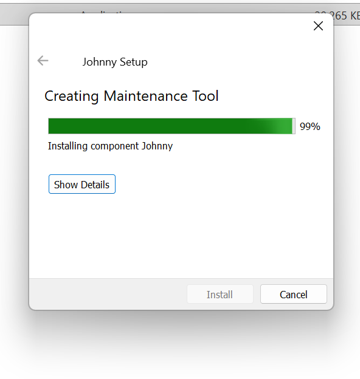
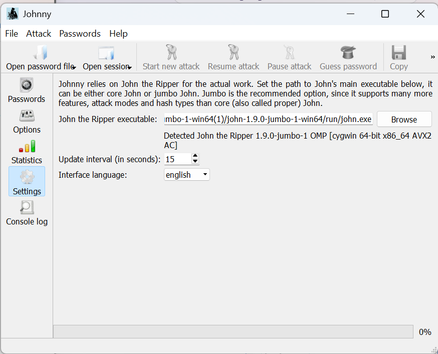
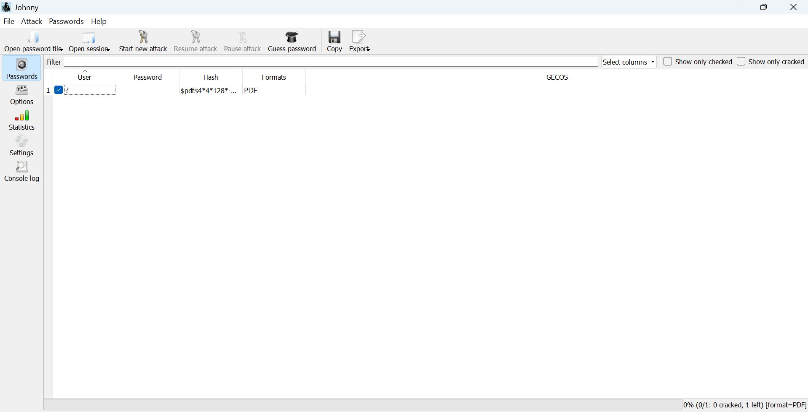
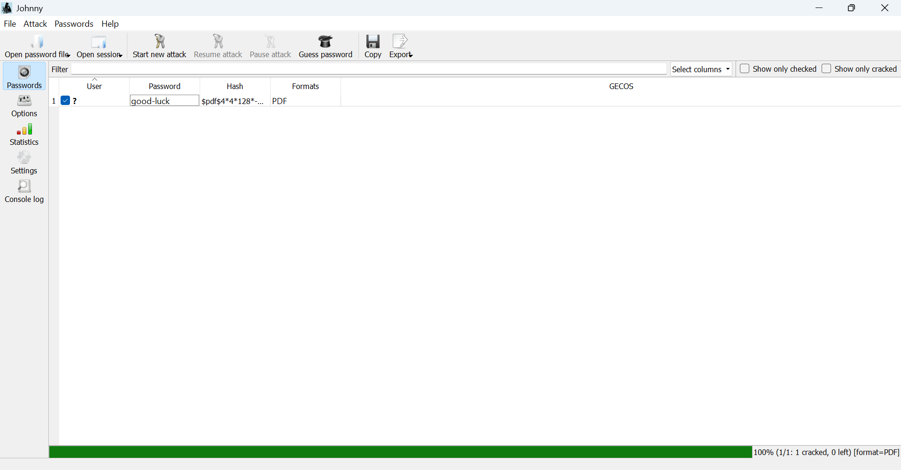
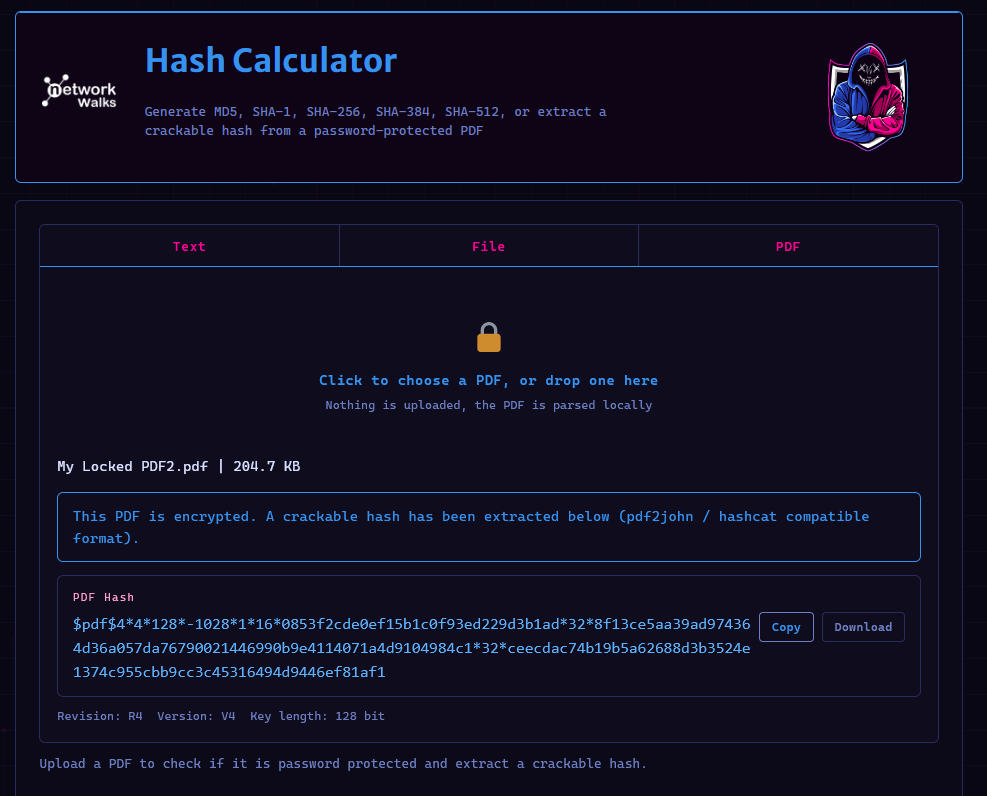
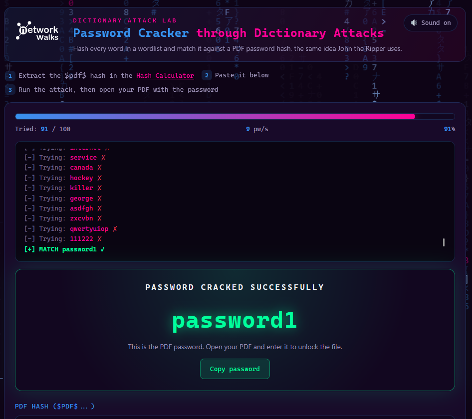
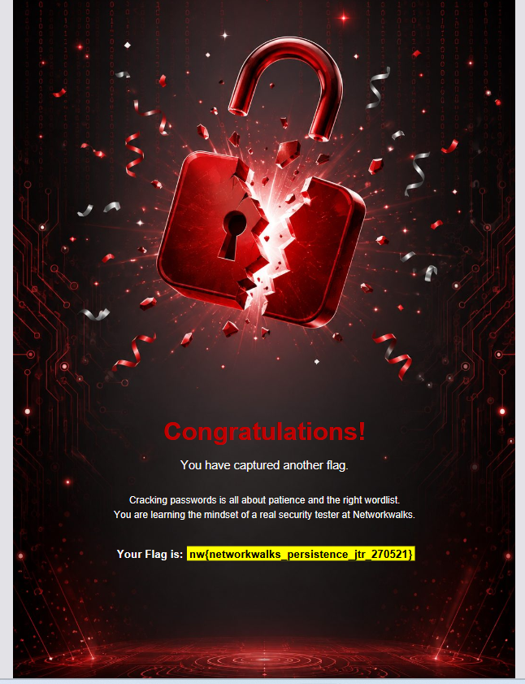

# Week 3 — Password Cracking (JTR & Networkwalks Tools)
**Networkwalks Cybersecurity Internship** | Intern ID: NW-084-3JO

## Overview
This week covered two approaches to recovering passwords from encrypted PDF files:
1. Password cracking with **John the Ripper (JTR)** + **Johnny GUI**
2. Password cracking with **Networkwalks' own Hash Calculator & Password Cracker** web tools

Both labs demonstrate the same underlying workflow: extract a crackable hash from a
password-protected file, then run a dictionary attack against it.

---

## Module 1: Password Cracking with JTR

**Tools:** John the Ripper 1.9.0-jumbo-1, Johnny GUI, Online Hash Crack (PDF hash extractor)

**Steps performed:**

1. Downloaded John the Ripper (jumbo build) and the Johnny GUI for Windows, then
   pointed Johnny to `john.exe` under the `run` directory — confirmed detection:

   

2. Extracted the PDF's crackable hash via onlinehashcrack.com's PDF hash extractor
   (format: `$pdf$4*4*128*-1028*1*16*...`):

   

3. Saved the hash to `hash1.txt` and loaded it into Johnny via **Open password file**:

   

4. Ran **Start new attack** — Johnny recovered the password via dictionary attack:

   

**Result:** Password cracked → `good-luck`

**Flag:** `nw{cybersecurity_flag_captured_2608}`

---

## Module 2: Password Cracking with Networkwalks Tools

**Tools:** Networkwalks Hash Calculator, Networkwalks Password Cracker

**Steps performed:**

1. Uploaded the locked PDF to the [Hash Calculator](https://networkwalks.com/hash-calculator/)
   — it parses the file locally in-browser and returns a pdf2john/hashcat-compatible hash:

   

2. Pasted the hash into the [Password Cracker](https://networkwalks.com/password-cracker/)
   and ran the dictionary attack (built-in 100-word list) — matched after 91/100 attempts (91 pw/s):

   

3. Opened the PDF with the recovered password to confirm.

**Result:** Password cracked → `password1`

**Flag:** `nw{networkwalks_persistence_jtr_270521}`

---

## Key Takeaways
- **Hashing vs. encryption:** encryption is reversible with the right key; hashing is
  one-way — password crackers work by hashing guesses and comparing, not "decrypting."
- Both a locally-run tool (JTR) and a lightweight browser-based tool arrived at the
  password quickly because the test passwords were short dictionary words — reinforcing
  why organizations should enforce passphrase complexity and length over simple words.
- `$pdf$` hash format is specific to PDF-protected files (distinct from a raw password
  hash), extracted via `pdf2john`-style tooling before any cracker can act on it.

## References
- [John the Ripper](https://www.openwall.com/john/)
- [Johnny GUI](https://openwall.info/wiki/john/johnny)
- [Online Hash Crack — PDF Hash Extractor](https://www.onlinehashcrack.com/tools-pdf-hash-extractor.php)
- [Networkwalks Hash Calculator](https://networkwalks.com/hash-calculator/)
- [Networkwalks Password Cracker](https://networkwalks.com/password-cracker/)
